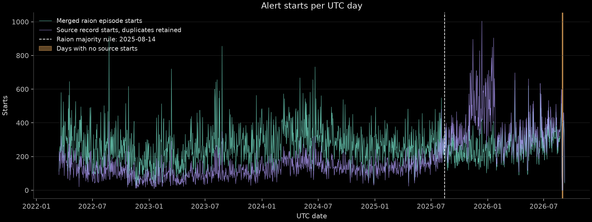
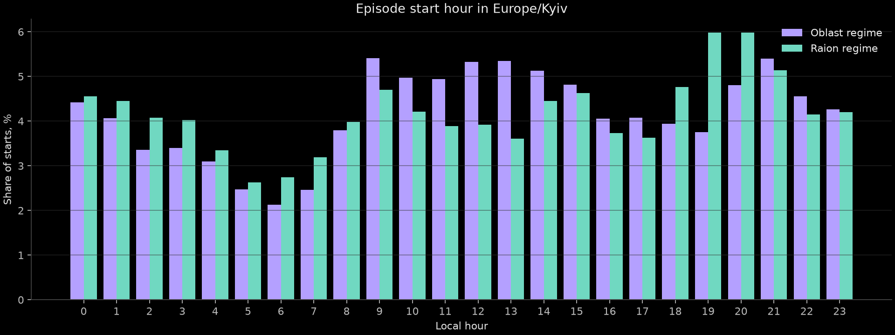
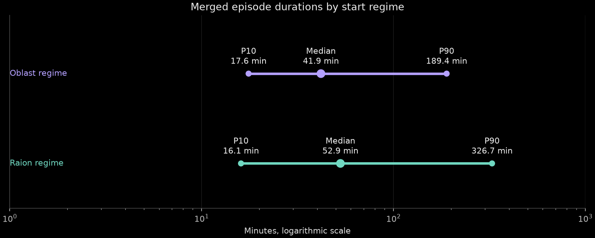
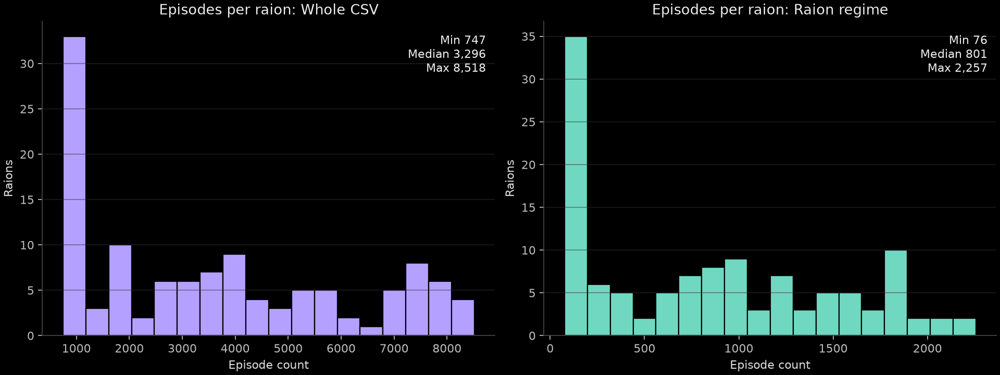

# Alert data and episodes

The saved `official_data_en_2026-10-12.csv` contains 299,275 source rows. Its latest timestamp floors to **2026-09-07T05:00:00Z**. The filename is the download date, not the last observation date. SHA256 is `b396f87696243069eec0219880e87dcd642b20beb0a7bae0d0e1f61e1ed20ec4`.

The full-history universe is 119 units, including 118 raions and `kyiv-city/kyiv-city`. Excluding two Luhanska source rows leaves **875,633 expanded records** and **431,094 merged episodes**. Oblast records cover their universe raions; hromadas cover the parent named in the CSV's `raion` column. No unit is selected by recent activity.

Reproduce with `uv run airalert episodes`, then `uv run python docs/eda/reproduce.py`. The first build took 3.18 seconds. All five figures were opened and visually inspected.

Expanded episode starts count raions, while source starts count original CSV rows. Source starts include duplicates. The highlighted days have no source starts and deserve a coverage review.

## Regime date

**2025-08-14** is the first UTC day whose trailing 14-calendar-day share of raion-level source rows exceeds 50% and stays above 50% through the last observed day. Count rows before geographic expansion; require a full 14-day window. Empty windows fail the rule. The final observed day is partial. This rule is retrospective metadata.

| Window ending on | Oblast share | Raion share | Hromada share |
|---|---:|---:|---:|
| 2025-08-13 | 36.71% | 47.08% | 16.21% |
| 2025-08-14 | 33.17% | 50.30% | 16.53% |

The minimum later raion share is 50.30%. Deduplicating source rows gives the same switch date. The alternative rule of a sustained oblast share below 50% gives **2025-08-05**. A sustained raion majority is a closer match to the requested regime definition. The saved data therefore contradicts the plan's December 2025 approximation. Raion shares are 58.2% in August, 73.1% in September and 91.1% in December 2025.

## Timing and duration

Hours use `Europe/Kyiv`, including daylight saving. The largest start share is at 09:00 in the oblast regime, 5.41%, and 20:00 in the raion regime, 5.99%. Each covered raion contributes its own episode.

| Episode start regime | Episodes | P10 duration | Median duration | P90 duration |
|---|---:|---:|---:|---:|
| Before 2025-08-14 | 330,556 | 17.58 min | 41.90 min | 189.42 min |
| From 2025-08-14 | 100,538 | 16.05 min | 52.93 min | 326.70 min |

Durations include short gaps absorbed by the merge rule. These counts use the entire CSV, including history before the configured forecast start. There are no censored episodes in this copy.

## Coverage by raion

| Period | Minimum episodes | Median episodes | Maximum episodes |
|---|---:|---:|---:|
| Entire CSV | 747 | 3,296 | 8,518 |
| Oblast regime | 628 | 2,210 | 6,581 |
| Raion regime | 76 | 801 | 2,257 |

No universe raion has zero episodes in the raion regime. The minimum is `dnipropetrovska/nikopolskyi`, 76; the maximum is `kharkivska/chuhuivskyi`, 2,257. Low observed activity alone does not establish occupation or reliable coverage.

## Facts for downstream agents

Read the regime date **2025-08-14** and snapshot **2026-09-07T05:00:00Z** from `snapshot.json`. `load_snapshot()` returns a frozen `Snapshot` with UTC `pd.Timestamp` fields `snapshot` and `regime_switch`, plus `csv_sha256`. The loaders return raion/start-sorted frames with `datetime64[us, UTC]` timestamps. Parquet uses `timestamp[us, tz=UTC]`.

These are descriptive onset base rates, calculated over every universe raion and hourly UTC forecast time from `config.TRAIN_START`, 2022-04-01, through `snapshot - H`. A positive row has an episode start in **(t, t+H]**. Regime is determined by forecast time; windows may cross the switch. Active hours remain in the denominator. These are full-history EDA rates, not fitted climatology or model scores, and include the suspected coverage gap.

| Horizon | Oblast-regime positives / rows | Base rate | Raion-regime positives / rows | Base rate |
|---|---:|---:|---:|---:|
| 1 h | 320,315 / 3,515,736 | 9.1109% | 98,386 / 1,111,579 | 8.8510% |
| 3 h | 841,826 / 3,515,736 | 23.9445% | 257,120 / 1,111,341 | 23.1360% |
| 12 h | 1,963,604 / 3,515,736 | 55.8519% | 584,025 / 1,110,270 | 52.6021% |

Data-quality and target rules:

- **113,845 exact source duplicates**, leaving 185,430 unique source rows. Keep every source row as required. Expansion yields 402,024 duplicate coverage rows. Episode union absorbs repeated coverage; downstream record counts should account for this multiplicity.
- **Four zero-length source rows**, representing two unique rows, and no negative durations. Keep zero-length records. One zero-length episode remains at `kharkivska/bohodukhivskyi`, `2025-11-17T01:13:53Z`. Duration training must explicitly handle this before taking logarithms. Negative source durations cause the build to fail rather than silently altering targets.
- **8,672 episodes contain actual cross-level overlaps**. There are 44,119 record starts during coverage from another level, duplicates included, and 8,882 episodes contain multiple levels. Merge using the running maximum end. A gap strictly shorter than `config.MERGE_GAP_MIN` merges; an exact five-minute gap does not. Equal earliest starts choose hromada, then raion, then oblast.
- **11,135 episodes are shorter than ten minutes**, 2.5830% overall; 2.4308% before the switch and 3.0834% after it.
- **No source starts or finishes on 2026-08-30, 2026-08-31 or 2026-09-01**. Adjacent start counts are 598 on August 28, 88 on August 29 and 241 on September 2. Twenty-eight raions remain covered by long records across the three days. This is a suspected coverage gap in the test period, not proof of no new alerts. A1 preserves the data; the lead should decide how to treat affected label windows before scoring.
- The CSV lists ended alerts only. There are no null `finished_at` values in this copy, so still-running alerts at the snapshot are invisible. Synthetic tests cover null-end censoring. Snapshot flooring leaves some raw timestamps in its final partial hour; as-of consumers still drop `started_at >= t` and mask `finished_at > t`.
- Use **records** for as-of features and **episodes** for labels and duration targets. Closing short gaps in full-data episodes would leak future starts into features.
