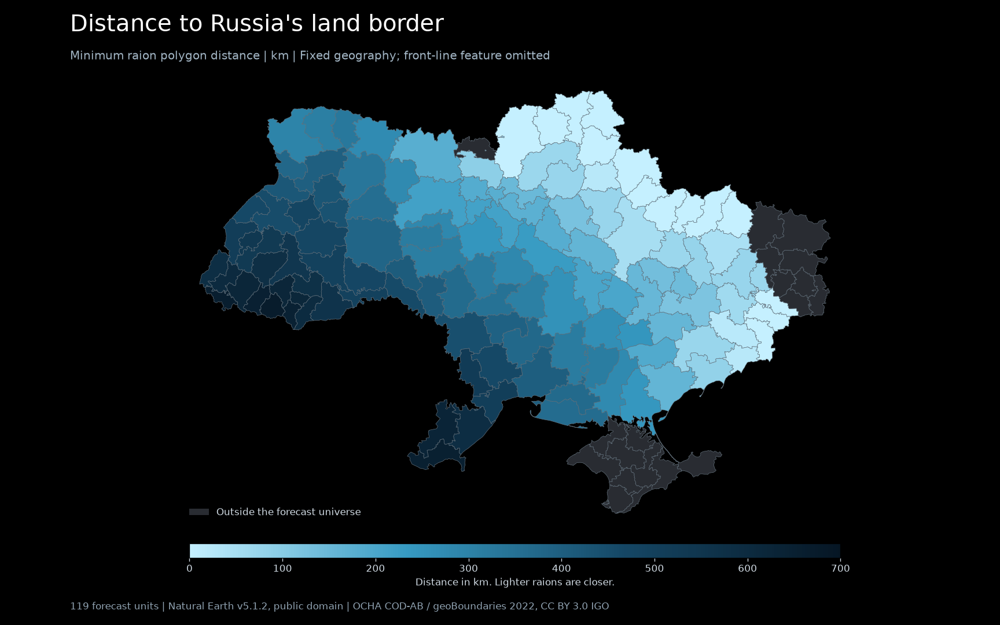

# Static geography features

M2c publishes `data/geo/static_features.csv`: 119 canonical `raion_id` rows and
seven finite float columns. The existing M2a feature loader joins these by ID
and prefixes each numeric column with `f_geo_`.

## Build and reproduce

Run `uv run python -m airalert.geo_features` to download missing pinned sources,
compute the CSV and render `docs/geo-features.png`. Run
`uv run python -m airalert.geo_features --offline` after caching. An offline
build fails if a source is missing or its SHA256 differs. A cached build makes
no HTTP requests even without `--offline`.

The full rebuild took 34.22 seconds with HTTP disabled. Its CSV was byte-identical
to the previous build. CSV SHA256:
`fa2076cd6514f32b2a1abac8172534f8d784d295b61dbdb2ca241d0d1476d1c4`.
Rows are sorted by `raion_id`; numeric columns use six decimal places and LF
line endings. Six decimal places make serialization stable, not the underlying
map accurate to millimetres.

## Sources, licenses and hashes

The Natural Earth downloads are pinned to
[v5.1.2](https://github.com/nvkelso/natural-earth-vector/releases/tag/v5.1.2),
released on 2022-05-13. Natural Earth permits reuse and modification of its map
data in the [public domain](https://www.naturalearthdata.com/about/terms-of-use/).
The three downloads total 5,618,162 bytes. They are cached under
`data/raw/geo/`, with filenames prefixed by `natural-earth-v5.1.2-`.

| Input | Use and license | SHA256 |
| --- | --- | --- |
| [Natural Earth 1:10m admin-0 land lines](https://raw.githubusercontent.com/nvkelso/natural-earth-vector/v5.1.2/geojson/ne_10m_admin_0_boundary_lines_land.geojson) | Russia and Belarus borders. Public domain. | `74d9c16229c095fde65943a9919e337682f044bcebccb120764f38edf3b70f4a` |
| [Natural Earth 1:10m marine polygons](https://raw.githubusercontent.com/nvkelso/natural-earth-vector/v5.1.2/geojson/ne_10m_geography_marine_polys.geojson) | Classify physical coastlines as Black Sea or Sea of Azov. Public domain. | `53f865e8ffa966cdd402145c82c5cd14ee7ce974cd0eb9a3f59f03a4cfd2d66c` |
| [Natural Earth 1:50m coastline](https://raw.githubusercontent.com/nvkelso/natural-earth-vector/v5.1.2/geojson/ne_50m_coastline.geojson) | Actual coastline segments, including bays, estuaries and islands. Public domain. | `271f1c4c1908312bac6b29d158ea1356544beafc129f260005300913aa5ea283` |
| [geoBoundaries humanitarian ADM2, 2022](https://github.com/wmgeolab/geoBoundaries/raw/9469f09/releaseData/gbHumanitarian/UKR/ADM2/geoBoundaries-UKR-ADM2.geojson) | Unsimplified raion polygons and Crimea, including Sevastopol. OCHA COD-AB / Kartographia, CC BY 3.0 IGO. | `d6d5de5b0a7849fb3d1993858f968198414c25d1135965fc496fd8187f444226` |

The 1:10m land-line file supplies explicit bordering-country attributes; the
1:50m file lacks them. The 1:10m marine file contains Sea of Azov, which is
absent from the 1:50m marine file. This is why those two inputs use 1:10m.

Raions and Crimea reuse the cached `gbHumanitarian-UKR-ADM2.geojson`, verified
against its existing metadata digest. `crosswalk.csv` resolves source
`shapeID` values to canonical IDs. No name rematching or centroid substitutes
are used. If this raw file is absent, the loader uses the existing simplified
`raions.geojson`. That fallback preserves coverage but changes areas and some
distances at the map's simplification precision. The delivered CSV uses the
unsimplified geometry. See [the geography provenance report](geo.md) and the
[OCHA source](https://data.humdata.org/dataset/cod-ab-ukr) for attribution.

The read-only local inputs used in this build have these SHA256 values:

| Input | SHA256 |
| --- | --- |
| `data/processed/raions.csv` | `56304501a58d2190fc921057b5ad2639b92018dce0b6502fda722c32252973f5` |
| `data/geo/crosswalk.csv` | `0b36347c3559e04017ea0e2f67acd80df053e065c9edb9261e96bb130012535f` |
| `data/geo/adjacency.json` | `326a0dbf9e4b5fb65d705224ade11d45dbc8f4c22b5b5b57026858b21b528cce` |
| `data/geo/centroids.csv` | `3a9e4258e958a32e885a2c1db0848c861056d90125a99e1811c27cfc35a8c0a9` |
| `data/geo/raions.geojson` | `407ef845c18519b83290c02ad6f2189b880754f0cf954c8154b65bfac156d4c7` |

## Meaning and measurement

All distances are the minimum from any point of a raion polygon to the target
geometry, in kilometres. A polygon that intersects a border, coastline or
Crimea has distance zero. This describes the closest part of a raion rather
than its population centre.

Distance calculations use a WGS84 Lambert conformal conic projection centred
at 49 N, 31 E with standard parallels 46 N and 52 N, in metres. Linework is
densified to at most 0.01 degrees per source-coordinate interval before
projection. An STRtree of short segments avoids repeatedly comparing distant
parts of long borders. Area uses the WGS84 ellipsoid through `pyproj.Geod`, with
consistent outer-ring and hole orientation.

| Column | Definition | Delivered min to max |
| --- | --- | --- |
| `dist_russia_border_km` | Nearest international land-border segment attributed to Russia. Includes Russia's borders with other countries and Kaliningrad. | 0 to 670.073 km |
| `dist_belarus_border_km` | Nearest international land-border segment attributed to Belarus, including its borders with other countries. | 0 to 635.243 km |
| `dist_black_sea_km` | Nearest physical Black Sea coastline segment. Includes coasts outside Ukraine. | 0 to 634.475 km |
| `dist_azov_sea_km` | Nearest physical Sea of Azov coastline segment. Includes coasts outside Ukraine. | 0 to 942.543 km |
| `dist_occupied_crimea_km` | Nearest point of the union of the map's Crimea and Sevastopol polygons. | 0 to 813.218 km |
| `area_km2` | Geodesic polygon area, including holes and all parts. | 834.253 to 11,075.260 square km |
| `n_neighbors` | Number of neighbors listed in the existing forecast-universe adjacency. Stored as float. | 2 to 9 |

Country-border distances follow the brief's nearest-country-land-border
definition. They are not restricted to that country's shared frontier with
Ukraine. For example, Uzhhorodskyi's nearest Russian land border is in
Kaliningrad. These features describe geography; they do not assert a threat
origin or a missile route.

Only Natural Earth lines with `TYPE = Land` and
`FEATURECLA = International boundary (verify)` are selected. Disputed lines
and water indicators are excluded. Natural Earth's separate disputed
Crimea/Kherson line therefore cannot create a false Russian national frontier
inside Ukraine. Its [admin-0 documentation](https://www.naturalearthdata.com/downloads/10m-cultural-vectors/10m-admin-0-boundary-lines/)
explains the default de facto treatment of disputed borders.

Sea polygons classify the nearest physical coast segment using segment
midpoints, with a 10 km maximum matching tolerance. That tolerance accommodates
the generalized marine outlines; it does not move the physical coast or add
10 km to distances. Each segment is assigned to the nearest of the two named
seas. Open-water delimiters, such as the division across Kerch Strait, never
become distance targets. Natural Earth warns that its
[physical-region polygons are approximate](https://www.naturalearthdata.com/downloads/10m-physical-vectors/10m-physical-labels/).
The coast data are also generalized at 1:50m scale, so local shoreline precision
and the division near Kerch should not be treated as survey accuracy.

Three real projected nearest-point pairs were independently checked with
WGS84 geodesic distances:

| Raion and target | Projected km | Geodesic km | Relative difference |
| --- | --- | --- | --- |
| Uzhhorodskyi to Russia | 583.767476 | 583.695567 | 0.012320% |
| Kyiv city to Belarus | 72.422932 | 72.482228 | 0.081808% |
| Odeskyi to Russia | 508.729285 | 509.336527 | 0.119222% |

## Front-line date decision

`dist_front_km` is omitted. No front-line geometry date was selected, downloaded
or silently substituted with today's map. A future addition must establish
both reuse permission for the underlying geometry and an exact historical
snapshot no later than 2026-07-31, before v2 validation begins on 2026-08-01.

The source checks on 2026-10-12 did not establish both requirements:

- [DeepStateMap's own API page](https://api.deepstatemap.live/request) is an
  application for access. I did not verify an openly reusable historical
  geometry license from the provider. The
  [cyterat archive](https://github.com/cyterat/deepstate-map-data) provides dated
  occupied-territory GeoJSON and a GPL-3.0 repository license. I could not
  verify that the scraper's GPL license grants reuse rights to DeepStateMap's
  underlying map data, so that archive was not used.
- The [WFP/OCHA ArcGIS service](https://atlas.geospatial.wfp.org/server/rest/services/UKR_Areas_of_Influence_Daily_by_OCHA_Server_MapImage/MapServer)
  exposes a layer named `UKR_AoI_OCHA_star_20250101` and credits ISW, CTP and
  OCHA. Its referenced ArcGIS item returned "Item does not exist or is
  inaccessible." I could not retrieve explicit reuse terms or verify that
  the publicly exposed geometry was an immutable 2025-01-01 snapshot.
- ISW's [mapping methodology](https://understandingwar.org/analysis/russia-ukraine/mapping-methodology-ukraine-product-line/)
  describes assessed control, but does not establish a reusable, dated
  geometry license. The attempted ISW terms page returned HTTP 403.

These are limits of the verification performed, not claims that the providers
forbid all reuse. The brief explicitly permits omission when an acceptable
dated source cannot be obtained. No line was invented from city locations or
administrative borders.

All seven delivered features are fixed geographic quantities. They read no
alert records, alert outcomes, live state, news or forecast clock. The Crimea
target is the already existing geographic peninsula, not a changing occupied
territory layer. There is no future front-line change to leak into validation
or test.

## Map inspection

I opened the rendered 1728 by 1080 PNG. The background is black, labels and the
0 to 700 km legend are readable, and the raion borders remain visible. The
raions along the northern and eastern Russian frontier are pale blue; western
and southwestern raions are darker. Northwest distances also reflect proximity
to Kaliningrad and Russia's Belarus frontier. Crimea, Sevastopol, Luhansk and
the Chornobyl zone are grey because they have no forecast-universe feature
row. The first render had a title/subtitle overlap; the delivered render
separates them. No front-line panel appears because that column was omitted.

## Delivery report

### Delivered

- `src/airalert/geo_features.py`: standalone builder, offline cache checks,
  polygon distances, geodesic areas and map rendering.
- `data/geo/static_features.csv`: 119 rows, seven float features, no missing or
  nonfinite values.
- `tests/test_geo_features.py`: four focused tests for published coverage,
  ranges and three geographic orderings; polygon distances versus geodesics;
  disputed-border exclusion; and offline cache integrity.
- `docs/geo-features.md` and `docs/geo-features.png`: this source/method report
  and the visually inspected dark map.
- Three pinned, hash-checked Natural Earth downloads under `data/raw/geo/`.
  Existing geography inputs and all v1 reports were read-only.

### Verified

- `uv run python -m airalert.geo_features --offline` produced:
  `Wrote 119 raions and 7 float features to data/geo/static_features.csv` and
  `Rendered docs/geo-features.png; dist_front_km omitted pending licensed dated geometry`.
- A full cached rebuild with `httpx.Client` replaced by a failing stub printed:
  `Offline rebuild: 34.22s; no HTTP; identical CSV SHA256 fa2076cd6514f32b2a1abac8172534f8d784d295b61dbdb2ca241d0d1476d1c4`.
- `uv run pytest tests/test_geo_features.py -q`: `4 passed in 1.28s`.
- `uv run ruff check src/airalert/geo_features.py tests/test_geo_features.py`:
  `All checks passed!`.
- Final `uv run ruff check --output-format concise`: `Found 3 errors.`
  All three are `E501` in `scripts/pre_commit_secret_guard.py`, lines 3, 14
  and 33. No owned file appears in the failures.
- The actual M2a `load_feature_context()` / `build_features()` path, using the
  real records at `2026-08-15T12:00Z`, returned 119 rows and seven finite
  `float32` `f_geo_*` columns. No model training or scoring was run.
- Three real geodesic nearest-point checks differed from the projected
  distances by 0.012320%, 0.081808% and 0.119222%.
- `docs/geo-features.png` was opened after the layout correction.
- The simplified-map fallback was exercised with the raw cache absent:
  `Simplified-map fallback: 119 valid matched polygons and Crimea geometry`.
- A focused scan of the four owned text artifacts found no user-home paths,
  email addresses or token patterns.

### Decisions and assumptions

Use unsimplified 2022 polygons, all international land borders of each named
country, physical coast segments and the map's existing Crimea polygons.
Exclude the disputed Crimea frontier. Omit the front-line feature until a
licensed, dated source is verified. Sources and their licenses are recorded
above. The existing M2a join consumes the delivered columns directly.

### Open issues

The optional front-line feature has no verified source. The repository-wide
`uv run ruff check` initially reported 13 errors in other owners' files during
concurrent implementation. The final check has three remaining `E501` errors
in the lead-owned `scripts/pre_commit_secret_guard.py`, at lines 3, 14 and 33.
The owned Python files are clean. The unrelated files were not edited.

### Contract change requests

None. The lead already exposes `config.V2_STATIC_FEATURES_PATH`, and M2a's join
accepts this table. The builder is invoked through `python -m`; no shared CLI
or configuration edit is needed.

### Dependencies added

None. The implementation uses the project's existing Shapely, pyproj, pandas,
NumPy, httpx and matplotlib dependencies. No commits or git state changes were
made.
