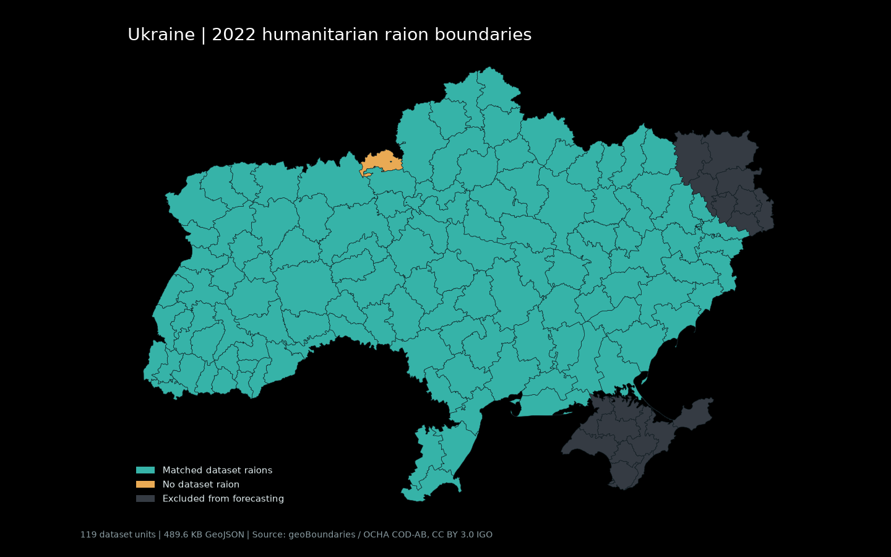

# Geography and crosswalk

## Sources and reproducibility

- [ADM1 API](https://www.geoboundaries.org/api/current/gbHumanitarian/UKR/ADM1/), [ADM1 full GeoJSON](https://github.com/wmgeolab/geoBoundaries/raw/9469f09/releaseData/gbHumanitarian/UKR/ADM1/geoBoundaries-UKR-ADM1.geojson). Boundary ID `UKR-ADM1-82583831`, represented year 2022, 27 units. Retrieved 2026-10-12T08:34:05.113911Z.
  License: Creative Commons Attribution 3.0 Intergovernmental Organisations (CC BY 3.0 IGO). Origin: [OCHA COD-AB / Kartographia](https://data.humdata.org/dataset/cod-ab-ukr). SHA256 `ae575f1b0202b28dfde4b934ff8744ee4c230b2198e08c00e6aef0534ba1d058`.
- [ADM2 API](https://www.geoboundaries.org/api/current/gbHumanitarian/UKR/ADM2/), [ADM2 full GeoJSON](https://github.com/wmgeolab/geoBoundaries/raw/9469f09/releaseData/gbHumanitarian/UKR/ADM2/geoBoundaries-UKR-ADM2.geojson). Boundary ID `UKR-ADM2-22097711`, represented year 2022, 139 units. Retrieved 2026-10-12T08:34:08.289621Z.
  License: Creative Commons Attribution 3.0 Intergovernmental Organisations (CC BY 3.0 IGO). Origin: [OCHA COD-AB / Kartographia](https://data.humdata.org/dataset/cod-ab-ukr). SHA256 `d6d5de5b0a7849fb3d1993858f968198414c25d1135965fc496fd8187f444226`.

Raw API metadata and full unsimplified boundaries are cached in `data/raw/geo/`. A cached rerun makes no HTTP requests and verifies both boundary SHA256 hashes. Mapshaper 0.7.83 is pinned and run through `bunx --no-install`; on a fresh machine first cache it with `bunx mapshaper@0.7.83 -v`.

Universe: `data/raw/official_data_en_2026-10-12.csv`, SHA256 `b396f87696243069eec0219880e87dcd642b20beb0a7bae0d0e1f61e1ed20ec4`. All dates contribute raion- and hromada-level parents; special-status cities without dataset raions contribute one unit. IDs and exclusions come from `airalert.ids` and `airalert.config`. If A1's `raions.csv` exists, the build requires identical ID sets.

## Matching and geometry

ADM2 has no parent-oblast attribute. Each polygon is assigned to the ADM1 polygon with greatest overlap, requiring at least 99% overlap. The smaller of the two ADM1 `Kyivska` polygons is Kyiv city. Its dataset unit is `kyiv-city/kyiv-city`.

Names match only within an oblast. Exact canonical IDs are tried first, then separator and transliteration-suffix normalization. Remaining aliases are explicit in `NAME_OVERRIDES`; no fuzzy or cross-oblast match is used. Each matched dataset ID has exactly one polygon.

Map labels use the dataset's English names for matched units, so Kyiv city and renamed raions display their dataset names. Crosswalk `shape_name` retains the original boundary name for auditability.

The 2022 source retains Novomoskovskyi and Novohrad-Volynskyi. [Resolution 3984-IX](https://zakon.rada.gov.ua/laws/show/3984-20) renamed the former to Samarivskyi; [resolution 2780-IX](https://zakon.rada.gov.ua/laws/show/2780-20) renamed the latter to Zviahelskyi. `Cnernivetskyi` is corrected to Chernivetskyi. These affect only the crosswalk, never the dataset IDs.

Mapshaper 0.7.83 constructs shared topology across all 139 polygons. Shared arcs use weighted simplification at a 500-metre interval, with intersection repair and `keep-shapes`, and are exported at four decimal places. Output is 489,623 bytes, 489.623 KB or 478.147 KiB, below the strict 600,000-byte target. Every output polygon must be valid and nonempty, and every positive-length border pair across all polygons must equal the unsimplified source pair set. Shapely's coverage check also rejects overlapping or mismatched polygon edges. [Mapshaper reference](https://mapshaper.org/docs/reference.html#simplify) documents shared topology and simplification.

Outer rings are clockwise and holes counterclockwise, using mapshaper's `reverse-winding` export for direct d3-geo rendering. [The export reference](https://mapshaper.org/docs/reference.html#o) documents this d3-compatible winding. The frontend can consume this artifact directly.

Adjacency uses unsimplified border intersections with strictly positive length. Point-only contacts do not count. Its keys include every universe ID, with missing geometries represented by empty lists. Excluded and unmatched polygons never appear as neighbours. Symmetry, uniqueness and no self-edges are asserted.

Centroids use EPSG:3035 area centroids and are transformed back to longitude/latitude. 2 matched polygons use an interior representative point because their centroid falls outside. Every point is checked against its unsimplified polygon.

## Coverage and G1 recommendation

- Source polygons: 139.
- Dataset units: 119; matched: 119.
- Dataset units without a polygon: 0 / 119 = 0.00%.
- Polygons without a dataset unit: 20, including 19 excluded polygons retained for Ukraine's complete outline.
- Match methods: {'exact': 115, 'override': 4, 'unmatched': 20}.
- G1 recommendation: retain raion units. The unmatched share is at or below 5%. This is a recommendation for the architect, not an implemented unit switch.

### Dataset units without polygons

None.

### Polygons without dataset units

| Shape ID | English source name | Oblast ID | Reason |
| --- | --- | --- | --- |
| `22097711B57509051638720` | Bakhchysaraiskyi | `autonomous-republic-of-crimea` | Excluded by config |
| `22097711B13302951022231` | Bilohirskyi | `autonomous-republic-of-crimea` | Excluded by config |
| `22097711B73657424691094` | Dzhankoiskyi | `autonomous-republic-of-crimea` | Excluded by config |
| `22097711B84451678573744` | Yevpatoriiskyi | `autonomous-republic-of-crimea` | Excluded by config |
| `22097711B47200263158981` | Kerchynskyi | `autonomous-republic-of-crimea` | Excluded by config |
| `22097711B98776447047182` | Kurmanskyi | `autonomous-republic-of-crimea` | Excluded by config |
| `22097711B45820000766767` | Perekopskyi | `autonomous-republic-of-crimea` | Excluded by config |
| `22097711B78464626697108` | Simferopolskyi | `autonomous-republic-of-crimea` | Excluded by config |
| `22097711B79933308021039` | Feodosiiskyi | `autonomous-republic-of-crimea` | Excluded by config |
| `22097711B78371574799870` | Yaltynskyi | `autonomous-republic-of-crimea` | Excluded by config |
| `22097711B27688590731099` | Chornobylska zona vidchuzhennia | `kyivska` | Absent from dataset |
| `22097711B73083160929140` | Alchevskyi | `luhanska` | Excluded by config |
| `22097711B68059533687998` | Dovzhanskyi | `luhanska` | Excluded by config |
| `22097711B53601754696899` | Luhanskyi | `luhanska` | Excluded by config |
| `22097711B34124994132375` | Rovenkivskyi | `luhanska` | Excluded by config |
| `22097711B77273801314169` | Svativskyi | `luhanska` | Excluded by config |
| `22097711B7670173734536` | Sievierodonetskyi | `luhanska` | Excluded by config |
| `22097711B56969234546212` | Starobilskyi | `luhanska` | Excluded by config |
| `22097711B68855027767264` | Shchastynskyi | `luhanska` | Excluded by config |
| `22097711B55202998529821` | Sevastopilska | `sevastopol-city` | Excluded by config |

## Adjacency

Min / median / max neighbours: 2 / 5 / 9. Undirected edges: 301. Zero-neighbour units: 0.

No isolated dataset units.

## Simplified map

The 1440 by 900 PNG renders the exported GeoJSON. Teal marks matched units, amber marks unmatched units, and grey marks excluded units. The full country outline includes Crimea, Sevastopol and Luhansk.
