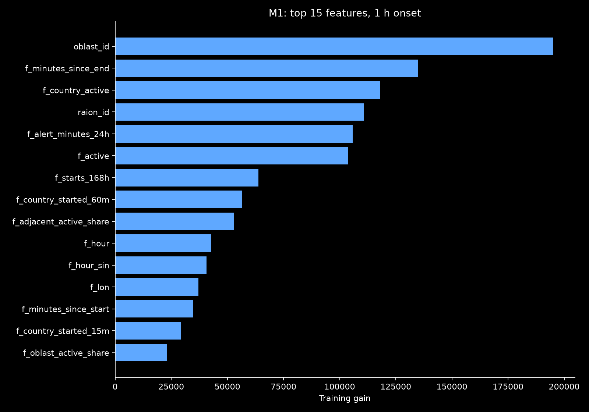
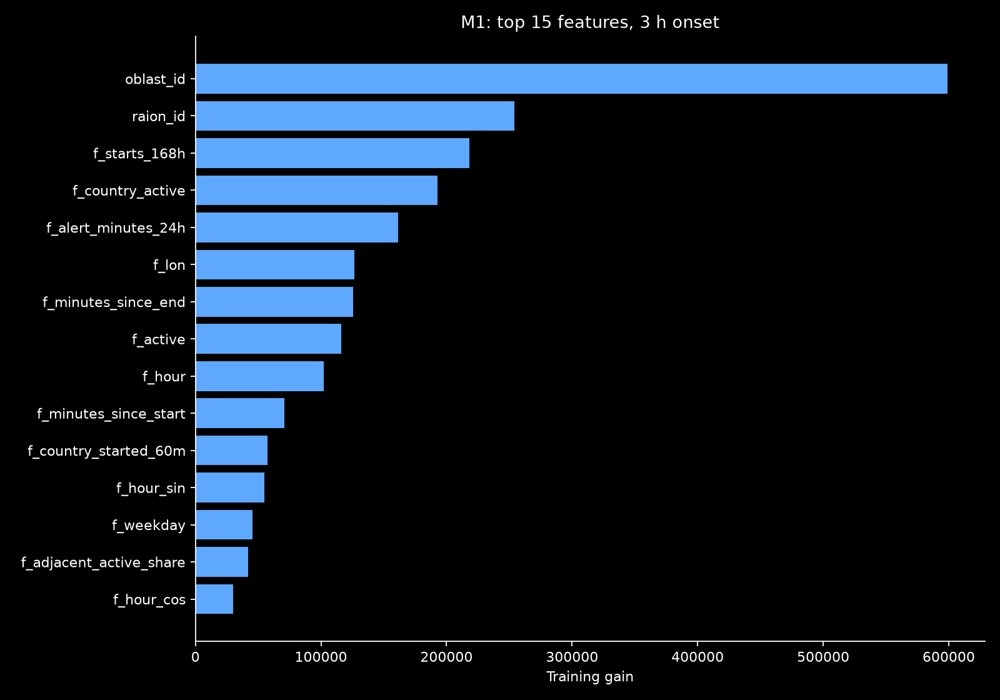
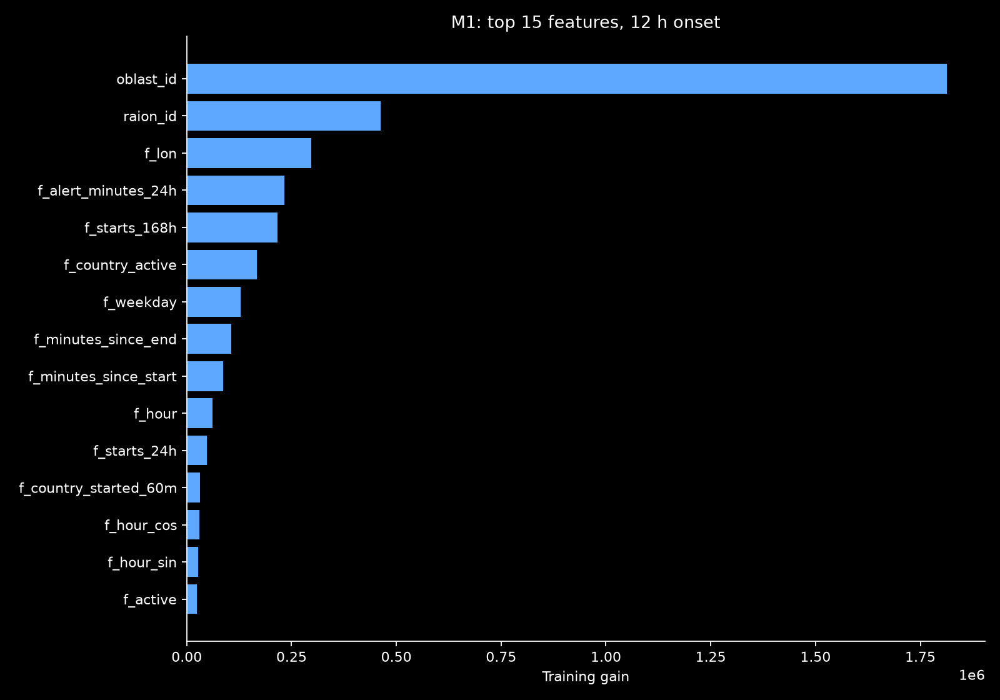

# Onset models

C1 trains one classifier for each configured horizon. The target is an episode
start in `(t, t+H]`. Features come from B1's as-of record features, and labels
come from merged episodes. The saved snapshot is `2026-09-07T05:00:00Z`.

## Features and protocol

B1 uses activity, starts over 6 and 24 hours, adjacent activity, national
activity, national starts over 60 minutes, and local-hour sine and cosine.
It also uses log1p ages since the most recent start and known end. Missing ages
become 1,000,000 minutes before the log, with separate missing indicators.
Full-history B1 includes the regime flag. A training-fitted StandardScaler
precedes L2 logistic regression with C=1.

M1 uses all 23 `f_*` columns plus categorical raion and oblast IDs. Its fixed
settings are 63 leaves, learning rate 0.05, minimum 200 rows per leaf, feature
and row sampling of 0.8, four threads and seed 42. There was no parameter search.
Early stopping monitors inner-holdout Brier, with at most 700 rounds and
50 rounds of patience.

Every training subset passes `backtest.trainable_mask`. Both full history
and the raion regime starting at the saved `2025-08-14` cutoff are compared.
The inner holdout starts at `2026-04-06T00:00:00Z`, eight weeks before validation.
Inner-training labels cannot cross that boundary. Neither the holdout nor
the refit can cross the outer training boundary. M1 refits all eligible rows
in its training window at the iteration count selected on the inner holdout.
Validation never selects iterations or fits the classifier or scaler.

Validation calibration fits June and July separately, then applies each fit
to the other month. Fit rows pass `backtest.scorable_mask`. June labels ending
after July 1 are embargoed. Those few seam forecast rows keep their raw
probabilities, preserving full prediction coverage without overlapping
calibration labels. There are 0, 238 and 1,309 such rows at 1, 3 and 12 hours.
The reported validation metric includes them. Test and latest probabilities
use a separate isotonic fit on all eligible validation rows. B1 applies
calibration only when this cross-fitted validation Brier improves by at least
1% relative to raw Brier, a threshold set before fitting.

Window comparisons minimize the sum of per-horizon validation Brier ranks.
With two windows this favors the window winning more horizons. Across all
reported models, selection favors the most per-horizon Brier wins.
The 3-hour Brier breaks ties. This chooses a single model for the dashboard.
The raw selected-window M1 is also published and scored as `M1-raw` so a
calibration loss cannot be hidden.

Training reads labels from train and validation only. Test and latest reads
explicitly select keys and features without any target columns. All fitting,
calibration and scoring exclusions use the shared 168-hour outage recovery.
Prediction files still cover every replay hour, including outage hours.

## Results

The served onset model is **M1, trained on the raion regime**. Its headline
3-hour test BSS against B0 is **0.138428578, or 13.843%**, with Brier
**0.142332186** on **80,325** forecast rows. Selection was written before
the single final scoring command. The duration selection is D1, as directed
by the lead.

### Validation

These are the real `scores_val.json` results, rounded to six decimals.
Every model uses the same eligible rows within a horizon.

| Model | H, hours | n | Brier | BSS vs B0 | Log-loss | PR-AUC |
|---|---:|---:|---:|---:|---:|---:|
| B0 | 1 | 174216 | 0.085156 | 0.000000 | 0.294586 | 0.225166 |
| B0 | 3 | 173978 | 0.152845 | 0.000000 | 0.459399 | 0.524431 |
| B0 | 12 | 172907 | 0.139615 | 0.000000 | 0.443871 | 0.875006 |
| B1 | 1 | 174216 | 0.079973 | 0.060862 | 0.276334 | 0.320331 |
| B1 | 3 | 173978 | 0.153087 | -0.001585 | 0.463902 | 0.545683 |
| B1 | 12 | 172907 | 0.159481 | -0.142296 | 0.491148 | 0.829477 |
| B1-full | 1 | 174216 | 0.080713 | 0.052172 | 0.280160 | 0.311474 |
| B1-full | 3 | 173978 | 0.153973 | -0.007376 | 0.468993 | 0.541127 |
| B1-full | 12 | 172907 | 0.157452 | -0.127762 | 0.487672 | 0.832557 |
| M1 | 1 | 174216 | 0.074394 | 0.126379 | 0.258385 | 0.407752 |
| M1 | 3 | 173978 | 0.135455 | 0.113777 | 0.416819 | 0.641005 |
| M1 | 12 | 172907 | 0.140450 | -0.005985 | 0.446094 | 0.891701 |
| M1-full | 1 | 174216 | 0.074676 | 0.123065 | 0.257433 | 0.401470 |
| M1-full | 3 | 173978 | 0.135521 | 0.113348 | 0.415878 | 0.639812 |
| M1-full | 12 | 172907 | 0.133157 | 0.046251 | 0.429828 | 0.899743 |
| M1-raw | 1 | 174216 | 0.074784 | 0.121800 | 0.255657 | 0.415551 |
| M1-raw | 3 | 173978 | 0.135912 | 0.110786 | 0.414332 | 0.646481 |
| M1-raw | 12 | 172907 | 0.139545 | 0.000499 | 0.434994 | 0.897318 |

**G3 PASS. M1 beats B0 at 2 of 3 validation horizons.** Its exact BSS values
are 0.12637948462252124, 0.11377748512009 and -0.005985235530920008.
The 12-hour loss remains visible in the table and selection note.

| Duration model | n | Pinball P10 | Pinball P50 | Pinball P90 | Median MAE, min | 80% coverage |
|---|---:|---:|---:|---:|---:|---:|
| D0 | 18262 | 12.297951 | 50.271519 | 45.241691 | 100.543038 | 0.782773 |
| D1 | 18262 | 12.164183 | 47.281587 | 39.680258 | 94.563174 | 0.774340 |

### Training windows and calibration

| Model/window | H=1 val Brier | H=3 val Brier | H=12 val Brier | Selected window |
|---|---:|---:|---:|---|
| B1 full | 0.080713 | 0.153973 | 0.157452 | |
| B1 raion regime | 0.079973 | 0.153087 | 0.159481 | B1 |
| M1 full | 0.074676 | 0.135521 | 0.133157 | |
| M1 raion regime | 0.074394 | 0.135455 | 0.140450 | M1 |

Both regime windows win at 1 and 3 hours, while full history wins at 12 hours.
The M1 3-hour window difference is only 0.000065682 Brier. Full history has
lower mean Brier across the three horizons, but the stated selection rule
favors the number of horizon wins and uses the headline horizon to break ties.
Across all six reported models, M1 wins two horizons and M1-full wins one.

M1's inner-selected iteration counts were 304/421/126 for full history and
114/124/92 for the regime window, at 1/3/12 hours respectively. These counts
were chosen before validation calibration or model selection.

For regime M1, calibration improves validation Brier by 0.000390 at 1 hour
and 0.000457 at 3 hours, but worsens it by 0.000905 at 12 hours. Raw M1's
12-hour BSS is slightly positive, while calibrated M1's is negative.
Calibration also worsens its validation log-loss and PR-AUC at all horizons.
The served B1 regime model stays uncalibrated at every horizon. B1-full applies
calibration only at 12 hours, where it clears the predefined 1% gain threshold.

### Test, evaluated once

These are the real `scores_test.json` results from the one
`uv run airalert backtest --final` invocation.

| Model | H, hours | n | Brier | BSS vs B0 | Log-loss | PR-AUC |
|---|---:|---:|---:|---:|---:|---:|
| B0 | 1 | 80563 | 0.094469 | 0.000000 | 0.318453 | 0.217172 |
| B0 | 3 | 80325 | 0.165201 | 0.000000 | 0.484246 | 0.524543 |
| B0 | 12 | 79254 | 0.134757 | 0.000000 | 0.432171 | 0.873946 |
| B1 | 1 | 80563 | 0.087256 | 0.076346 | 0.295616 | 0.331215 |
| B1 | 3 | 80325 | 0.159632 | 0.033706 | 0.477430 | 0.572743 |
| B1 | 12 | 79254 | 0.150792 | -0.118995 | 0.470384 | 0.843047 |
| B1-full | 1 | 80563 | 0.087519 | 0.073568 | 0.297987 | 0.328192 |
| B1-full | 3 | 80325 | 0.159751 | 0.032988 | 0.481041 | 0.569464 |
| B1-full | 12 | 79254 | 0.145318 | -0.078371 | 0.451800 | 0.852406 |
| M1 | 1 | 80563 | 0.082083 | 0.131105 | 0.274675 | 0.400666 |
| M1 | 3 | 80325 | 0.142332 | 0.138429 | 0.430139 | 0.650148 |
| M1 | 12 | 79254 | 0.131845 | 0.021608 | 0.409537 | 0.907104 |
| M1-full | 1 | 80563 | 0.081990 | 0.132089 | 0.273505 | 0.399382 |
| M1-full | 3 | 80325 | 0.141975 | 0.140589 | 0.428817 | 0.650690 |
| M1-full | 12 | 79254 | 0.122168 | 0.093416 | 0.385455 | 0.915336 |
| M1-raw | 1 | 80563 | 0.082803 | 0.123485 | 0.277431 | 0.409066 |
| M1-raw | 3 | 80325 | 0.143608 | 0.130707 | 0.432162 | 0.656621 |
| M1-raw | 12 | 79254 | 0.131979 | 0.020612 | 0.412908 | 0.910575 |

M1-full beats the selected M1 on test Brier at every horizon, including
3-hour BSS of 14.059% versus 13.843%. This did not change the frozen
selection. The test set was not used to refit or choose a window.

| Duration model | n | Pinball P10 | Pinball P50 | Pinball P90 | Median MAE, min | 80% coverage |
|---|---:|---:|---:|---:|---:|---:|
| D0 | 10898 | 11.470864 | 47.358297 | 42.962422 | 94.716593 | 0.771609 |
| D1 | 10898 | 11.511641 | 45.305372 | 38.518912 | 90.610744 | 0.759772 |

### Frozen selection

Exact `reports/metrics/selection.json`, written before test scoring:

```json
{
  "generated_at": "2026-10-12T09:46:44.475218Z",
  "selection": {
    "onset": "M1",
    "duration": "D1",
    "note": "Raion-regime M1 wins validation Brier at 1 h and 3 h, passing G3 with BSS versus B0 of 12.64%, 11.38% and -0.60% at 1/3/12 h; full-history M1 is stronger at 12 h. Selection favors the most horizon wins with 3 h as the tiebreaker, and D1 is the lead's duration choice."
  }
}
```

The combined SHA256 over 56 prediction, fitted-model and selection files was
`cc1b9c520f5dd70b31afd0ff5fff5c9a454212a30f274a85a5811c0db10d3a67`
both before and after final scoring and precompute.

### Gain importance

All three top-15 plots were opened and visually inspected. Raion and oblast
categories have substantial training gain. Gain does not establish causation.





## Limitations

The source lists alerts only after they end. Alerts still running at the saved
snapshot can therefore be absent from latest features. The outage and its
168-hour recovery remove test scores from late August onward. These are
retrospective replay results, not evidence of performance on live alerts.

The dashboard's precompute stage enforces probability ordering across horizons.
Backtest evaluates each model's original per-horizon probabilities before that
serving transformation, as specified by the shared pipeline.

## Delivered

- `src/airalert/models/onset.py` and `tests/test_onset.py`.
- `data/processed/preds/onset_{B1,B1-full,M1,M1-full,M1-raw}.parquet`.
  Each has 279,293 rows: 174,216 validation, 104,958 test and 119 latest.
- `artifacts/B1/`, `artifacts/B1-full/`, `artifacts/B1-raionregime/`,
  `artifacts/M1/`, `artifacts/M1-full/`, `artifacts/M1-raionregime/` and
  `artifacts/M1-raw/`. They contain fitted models, serving calibrators where
  applied, feature/category definitions, training-time boundaries, input hashes
  and validation comparison metadata.
- `reports/metrics/selection.json`,
  `reports/figures/onset_importance_{1,3,12}h.png`, and this write-up.
- The permitted backtest/precompute commands produced their owners' score
  fragments, combined report, reliability figures and forecasts Parquet.

## Verified

The actual training CLIs returned exit 0. B1 took 22.41 seconds and M1 took
250.61 seconds. Their real final publication output included:

```text
Wrote onset_B1-full.parquet: 279293 rows {'latest': 119, 'test': 104958, 'val': 174216}
Wrote onset_B1.parquet: 279293 rows {'latest': 119, 'test': 104958, 'val': 174216}
Wrote onset_M1-full.parquet: 279293 rows {'latest': 119, 'test': 104958, 'val': 174216}
Wrote onset_M1.parquet: 279293 rows {'latest': 119, 'test': 104958, 'val': 174216}
Wrote onset_M1-raw.parquet: 279293 rows {'latest': 119, 'test': 104958, 'val': 174216}
```

A production training-clock audit used train keys and labels only:

```text
H=1: refit=4346832 inner_train=4186896 inner_holdout=159936 inner_embargo=0 max_refit_label_end=2026-06-01 00:00:00+00:00
H=3: refit=4346594 inner_train=4186658 inner_holdout=159698 inner_embargo=238 max_refit_label_end=2026-06-01 00:00:00+00:00
H=12: refit=4345523 inner_train=4185587 inner_holdout=158627 inner_embargo=1309 max_refit_label_end=2026-06-01 00:00:00+00:00
Production training clock audit PASS; no test labels read
```

All five C1 Parquet files passed exact feature-key and finite [0,1] checks.
Reloaded B1 pipelines reproduced 100 validation forecasts per horizon within
float32 tolerance. One overly strict initial 1e-12 comparison failed on a
5.96e-8 batch-rounding difference; the corrected float32 check passed.
Reloaded M1 boosters and serving calibrators reproduced 100 test probabilities
per horizon within 1e-12, without reading or scoring target columns.

`uv run airalert backtest`, exit 0, produced the validated fragment. A Python
read of that fragment printed the complete validation table above. CLI output:

```text
Wrote scores_val.json: 18 onset and 2 duration scores
Validated metrics.json: 18 onset, 2 duration scores
```

`uv run airalert backtest --final` was invoked once and returned exit 0.
A Python read of its validated fragment printed the complete test table above.
Its actual gap masks and completion output were:

```text
test H=1 masks: {'rows': 104958, 'embargo': 0, 'data_gap': 24395, 'null_label': 0, 'excluded_union': 24395}
test H=3 masks: {'rows': 104958, 'embargo': 0, 'data_gap': 24633, 'null_label': 0, 'excluded_union': 24633}
test H=12 masks: {'rows': 104958, 'embargo': 0, 'data_gap': 25704, 'null_label': 0, 'excluded_union': 25704}
Wrote scores_test.json: 18 onset and 2 duration scores
TEST SET SCORED (--final explicitly enabled)
Validated metrics.json: 36 onset, 4 duration scores
```

`uv run airalert precompute`, exit 0, actual output:

```text
Forecasts: 279,293 rows; 119 raions; 2,347 hours
Range: 2026-06-01T00:00:00+00:00 -> 2026-09-07T05:00:00+00:00
Served models: onset=M1; duration=D1
Wrote .\data\processed\forecasts.parquet; total 1.51s
```

The real serving artifacts were loaded through FastAPI's lifespan and
TestClient. Responses validated against the shared schemas. Actual output:

```text
/api/meta 200: onset=M1 duration=D1 raions=119 snapshot=2026-09-07T05:00:00+00:00
/api/forecast 200: mode=latest, 119 rows, ordered probabilities, onset=M1
/api/forecast 200: mode=replay, 119 rows, ordered probabilities, onset=M1
/api/raion/kyiv-city/kyiv-city/history 200: 25 hourly forecasts, 2 episodes
/api/report 200: 36 onset and 4 duration scores; selection=M1/D1
Frozen 56 model/prediction/selection files UNCHANGED after final scoring and precompute
```

`uv run pytest tests/test_onset.py`, exit 0, final real output:

```text
============================= test session starts =============================
platform win32 -- Python 3.12.13, pytest-9.1.1, pluggy-1.6.0
rootdir: .
configfile: pyproject.toml
plugins: anyio-4.15.1
collected 5 items

tests\test_onset.py .....                                                [100%]

============================== 5 passed in 1.60s ==============================
```

`uv run ruff check src/airalert/models/onset.py tests/test_onset.py`, exit 0:

```text
All checks passed!
```

## Decisions/assumptions

The selection rule interprets per-horizon Brier comparison as favoring the
most horizon wins, with H=3 breaking ties. Each family retains a single training
window across all horizons. The June/July seam retains raw probabilities to
meet the exact-key contract while withholding those rows from cross-fold
calibration. B1's 1% calibration threshold and M1 defaults were set before
validation evaluation. The test run caused no model or selection changes.

C1 made no git state changes. Direct writes stayed within C1 ownership;
other report/forecast outputs came from the explicitly permitted CLIs.

## Open issues

No implementation blockers remain. The 12-hour validation calibration loss,
test advantage of full-history M1, and source limitations are reported above.
The API verification emitted the installed Starlette TestClient's existing
httpx deprecation warning; all real-data responses passed. Frontend interaction
was outside this model task's ownership and was not claimed as verified.

## Contract change requests

None.

## Dependencies added

None. joblib and threadpoolctl were already installed with scikit-learn.
