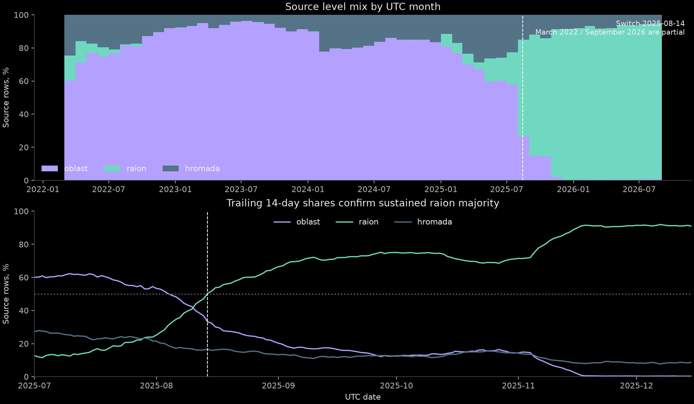
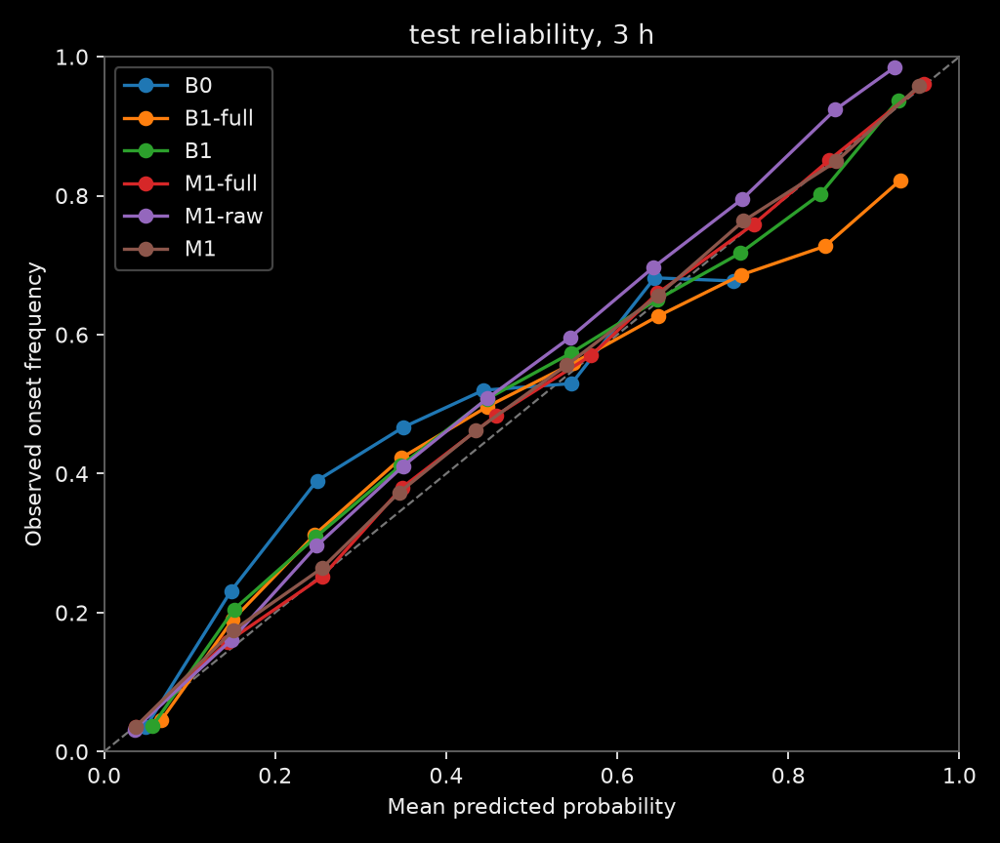

# Air Alert Forecaster report

This is the frozen v1 evaluation. For live data, current forecasts and the newer evaluation, read the [v2 overview](overview-v2.md), [onset report](report-v2.md) and [duration report](duration-v2.md). The v1 numbers below are unchanged.

The selected raion-regime LightGBM model, M1, achieves **13.843% test Brier skill versus climatology at 3 hours**, with Brier 0.142332 on 80,325 forecast rows. Full-history M1 has lower test Brier at every horizon, but validation selected the raion-regime model before test scoring. The duration intervals under-cover their nominal probability.

Results below come from the frozen [`reports/metrics.json`](../reports/metrics.json). Data and implementation facts cite the agent notes; [AGENTS.md](../AGENTS.md) takes precedence where an earlier handoff describes a policy that later changed.

## Problem

For each raion `r` and hourly UTC forecast time `t`, estimate the probability that a merged alert episode starts in `(t, t+H]`, for H of 1, 3 and 12 hours. A raion can already be active at `t`; the target still asks whether a new episode starts within the horizon.

At an episode's onset `s`, predict its total duration's P10, P50 and P90 in minutes. The P10-P90 range is intended to cover 80% of durations. It is an onset-time prediction and does not update conditional on how long the alert has already lasted.

## Data

The input is `official_data_en.csv` from [Vadimkin/ukrainian-air-raid-sirens-dataset](https://github.com/Vadimkin/ukrainian-air-raid-sirens-dataset). The upstream repository declares an [MIT license](https://github.com/Vadimkin/ukrainian-air-raid-sirens-dataset/blob/main/LICENSE). The volunteer dataset is not used for labels because some of its ends are synthetic, as described in the [original plan](plan.md).

The saved download, `official_data_en_2026-10-12.csv`, contains 299,275 source rows and **ends on 2026-09-07**, despite its October acquisition date. Its hourly snapshot is **2026-09-07T05:00:00Z**. The source SHA-256 in `data/processed/snapshot.json` is:

```text
b396f87696243069eec0219880e87dcd642b20beb0a7bae0d0e1f61e1ed20ec4
```

[EDA](eda.md) reports 875,633 expanded coverage records and 431,094 merged episodes after exclusions. The fixed universe is **119 units**, comprising 118 raions and Kyiv City. It includes every raion or hromada parent in the full source history, plus special-status cities without dataset raions. It does not select units by test-period activity.

Luhansk, the Autonomous Republic of Crimea, and Sevastopol are excluded. Permanent alerts are not represented reliably in this ended-alert dataset. Luhansk has only oblast-level source rows; Crimea and Sevastopol have no source rows. These areas remain on the map with no forecast, rather than being interpreted as safe or inactive. [AGENTS.md](../AGENTS.md) records the exclusions and their reason.

The data-derived **regime switch is 2025-08-14**. It is the first day when the trailing 14-day raion-level source-row share exceeds 50% and stays above that level to the last observed day. Deduplication gives the same date. The plan guessed December 2025; the observed change is earlier. This is retrospective metadata, not an online detector. [EDA](eda.md#regime-date) explains the calculation.



There is a nationwide **source outage of about 4.3 days**, from late August 29 to September 2. The scoring policy uses the hour-aligned interval `[2026-08-29T06:00Z, 2026-09-02T14:00Z)`. Missing observations must not become negative labels. Hourly onset training, calibration and scoring exclude any row whose label window touches that interval, and any forecast time inside the outage or its **168-hour recovery**. Recovery covers the longest feature lookback. It extends beyond the nominal test end, leaving roughly August 1 to August 29 for scored onset forecasts. Duration eligibility instead excludes episodes overlapping the outage. [AGENTS.md](../AGENTS.md) and the [B2 handoff](../reports/B2-handoff.md) describe the final policy; the earlier 24-hour recovery concern in the feature handoff was resolved by extending it.

There are **113,845 exact source duplicates**, about **38%** of the source rows. Raw records retain them. Counts drop exact coverage duplicates before counting distinct start times per raion; equal starts across levels count once. Episode union absorbs duplicate coverage. [EDA](eda.md#facts-for-downstream-agents) and [feature notes](features.md#time-and-counting-rules) distinguish these counting rules.

The source lists alerts only after they end. This copy has no null `finished_at` values, so genuinely ongoing alerts at the snapshot are invisible. Reconstructing active alerts from retrospectively saved records is possible for replay, but does not reconstruct when the publisher made those records available.

Other descriptive figures are [daily starts](eda/daily-starts.png), [Kyiv-hour timing](eda/kyiv-hours.png), [duration by regime](eda/duration-regimes.png), and [episodes per raion](eda/episodes-per-raion.png). Their full-history statistics include the outage and are not model scores.

## The as-of rule

Hourly forecast features use only starts strictly before `t`. The required reconstruction drops `started_at >= t` and masks `finished_at > t` to null. Ends exactly at `t` count as known under this reconstruction. Fixed geography and the saved regime cutoff stay unchanged.

Features read **records, never full-data merged episodes**. Suppose an alert ends, then another starts a few minutes later. Full-data merging fills that short gap and can make the earlier forecast appear active before the later start was known. Record-prefix coverage leaves the gap uncovered. Episodes supply future targets, while record prefixes supply feature inputs.

The [leakage guard](features.md#leakage-guard), implemented in [`tests/test_leakage.py`](../tests/test_leakage.py), compares every feature from full records against the reconstructed view at **50 random hourly times**, plus the snapshot and adversarial probes at a start, one microsecond after it, an end, and inside a real merge gap. The same checker must reject a planted feature that reads the eventual duration of an alert still running at `t`. The test succeeds only if that planted leak raises the expected mismatch. Synthetic cases also cover duplicates, overlaps, zero-length records, missing ends, and window boundaries.

A passed event-time reconstruction test establishes causality within the saved records. It does not prove historical publication availability. The original plan described data published before `t`; the ended-only CSV has no publication timestamps to support that stronger claim.

Two further controls protect evaluation:

- The shared embargo excludes training or validation rows when `t+H` crosses the next split start. A label ending exactly at that boundary remains eligible. Inner-training and calibration-fold boundaries apply the same principle.
- The shared gap mask removes outage label windows and corrupted onset lookbacks before fitting, calibration or scoring. Prediction files retain those hours for replay. Duration scoring also excludes censored episodes, split-crossing ends, and gap overlaps.

Duration predictions are made at episode onset `s`, when the alert is issued. [AGENTS.md](../AGENTS.md#hard-rule-the-as-of-contract) explicitly permits records with `started_at <= s`, including the starting record's source level and simultaneous starts, with ends after `s` masked. This is the design in [plan §03, Target (d)](plan.md); the strict `< t` rule governs hourly onset features. [Duration notes](duration.md#decisionsassumptions) and [duration tests](../tests/test_duration.py) use this inclusive start-prefix reconstruction.

Selection froze before the single final scoring run recorded in [onset evidence](onset.md#test-evaluated-once). The JSON timestamps corroborate that ordering: [`selection.json`](../reports/metrics/selection.json) is dated **2026-10-12T09:46:44.475218Z**, before [`scores_test.json`](../reports/metrics/scores_test.json) at **2026-10-12T09:48:02.029497Z**. The onset handoff records unchanged model, prediction and selection hashes across final scoring and precompute. This report reads the scores without rerunning evaluation.

## Method

### Episodes, labels and time splits

Oblast records expand to all covered universe raions; hromada records map to their parent raion. Overlaps and gaps strictly shorter than the configured five minutes merge into one episode. An exact five-minute gap remains separate. The duration target includes absorbed gaps. The one zero-length episode is clipped to one minute before logging or scoring. [EDA](eda.md#facts-for-downstream-agents) records these cases.

Onset labels include starts in `(t, t+H]`: a start at `t` is excluded, one at `t+H` is included. Labels are null when the horizon ends after the snapshot; latest labels are always null. UTC controls splitting, and Europe/Kyiv controls calendar features and displayed time.

| Split | Forecast-time range, UTC | Role |
|---|---|---|
| Train | 2022-04-01 inclusive to 2026-06-01 exclusive | Fit classifiers, scalers, and climatology |
| Validation | 2026-06-01 inclusive to 2026-08-01 exclusive | Compare windows/models and calibrate onset probabilities |
| Test | 2026-08-01 inclusive through 2026-09-06T17:00Z inclusive | One final evaluation after freezing selection |
| Latest | 2026-09-07T05:00Z only | Snapshot forecast with no outcome label |

These are the [contract ranges](../AGENTS.md). Horizon-specific embargo and gap masks reduce scored rows. Duration splits use episode starts; train and validation episodes must also end strictly before the next split. Test episode ends must be observed by the snapshot. Duration excludes gap-overlapping episodes, rather than applying the hourly onset recovery mask. [Duration notes](duration.md#decisionsassumptions) explain why prediction coverage and scoring eligibility are separate.

### Features

The [feature dictionary](features.md#feature-dictionary) defines 23 float32 onset columns. Sorted arrays and `searchsorted` evaluate whole time vectors within each raion, avoiding a Python loop over forecast rows.

| Group | Inputs |
|---|---|
| Own alert activity | Active flag; minutes since last distinct record start and known end; starts over 1, 6, 24 and 168 hours; actual covered minutes over 24 hours |
| Geography | Centroid latitude and longitude |
| Neighbours and oblast | Adjacent active share; adjacent starts over 30 and 60 minutes; oblast active share |
| Country | Number of active raions; number with a start over 15 and 60 minutes |
| Calendar | Kyiv hour, hour sine/cosine, weekday, weekend flag |
| Regime | Indicator using the saved August 14 cutoff |

Start-count windows are `[t-W, t)`. Coverage minutes clip at `t` and retain real short gaps. Missing event ages stay missing until model-specific handling.

All 119 dataset units matched one polygon, so the planned oblast fallback was unnecessary. The [geography build](geo.md) uses 2022 geoBoundaries gbHumanitarian / OCHA COD-AB boundaries, simplifies shared topology, and preserves border adjacency. Centroids are fixed geographical proxies, not measured front-line distance.


### Models and calibration

| Model | Construction |
|---|---|
| B0 | Training-only raion × Kyiv hour × weekday/weekend climatology, shrunk toward oblast cells with coarser fallbacks; validation chooses shrinkage and training window per horizon |
| B1 | L2 logistic regression on selected activity/spread/calendar features and log event ages; training-fitted scaling and explicit missing-age indicators |
| M1 | LightGBM classifier per horizon across all raions, using every onset feature plus categorical raion and oblast IDs |
| D0 | Training-only empirical duration quantiles by oblast × six-hour Kyiv bucket × regime, with coarser fallbacks for sparse cells |
| D1 | Three LightGBM quantile models on log duration; sorted, minimum-one-minute predictions transformed back to minutes |

B1 and M1 compare full-history training with training from the saved raion-regime cutoff. The regime-only winners are named B1 and M1; `-full` denotes the reported full-history alternative. `M1-raw` exposes the selected window before isotonic calibration.

For M1, early stopping uses an **inner train holdout beginning 2026-04-06**, eight weeks before validation. An inner embargo prevents labels crossing that boundary. The classifier then refits eligible training rows at the chosen iteration count. Validation does not fit classifier parameters or select iterations. Hyperparameters were fixed without a parameter search. [Onset protocol](onset.md#features-and-protocol) gives the settings.

Onset isotonic calibration uses June/July cross-fitting on validation. M1's calibrated June probabilities use a fit on July outcomes, and its calibrated July probabilities use a fit on June outcomes. The lead deliberately chose this protocol so validation rows never calibrate themselves. July outcomes still influence June probabilities, so **validation scores are a model-comparison diagnostic, not chronological as-of forecasts**, as [AUD-01](audit.md#findings) confirms. June fit rows whose label windows cross July 1 are excluded; those seam rows keep raw probabilities in the validation output.

Test/latest use a separate calibrator fitted on all eligible validation rows. That calibration period comes entirely before test, so the headline test results are chronologically valid under the saved record-time reconstruction. Historical publication availability remains unverified. The lead retained the validation protocol after the audit because changing it after test scoring would re-open model selection after seeing the test set.

B1 applies calibration only if cross-fitted validation Brier improves by at least 1% relative to raw Brier; the selected B1 stays raw at all horizons. M1 applies calibration and also reports its raw alternative.

Duration uses onset context, local calendar/regime, current national/oblast activity, recent starts, and causal summaries of previously ended episodes. Recent episode history is rebuilt from record prefixes, so future merge extensions cannot change a past feature. D1 compares full-history and regime-only training and two tree sizes. **D1 uses validation for early stopping and candidate selection**, so its validation scores are tuning results. It selects regime-only training. It has no isotonic calibration. [Duration method](duration.md#decisionsassumptions) documents this protocol.

Onset selection favors the model with the most per-horizon validation Brier wins, using 3-hour Brier to break ties. M1 wins at 1 and 3 hours; M1-full wins at 12 hours. This rule chooses one onset model for the dashboard, even though full-history M1 has lower mean validation Brier across horizons. The lead chose D1 for duration after its validation comparison with D0. Both selections remain frozen in [`selection.json`](../reports/metrics/selection.json).

### Reproducibility notes

Saved M1 artifacts retain only the all-validation isotonic calibrators used for test and latest. The June/July fold calibrators are not saved. The [independent audit's AUD-03 finding](audit.md#findings) records exact reproduction of validation predictions by refitting those folds from saved-model raw outputs and validation labels. Validation replay therefore requires those labels and a fold refit alongside the saved model.

## Results

The headline is **M1's 13.843% test BSS versus B0 at 3 hours**. Its Brier is 0.142332, compared with B0's 0.165201, on the same 80,325 rows.

Brier and log-loss measure probability error, so lower is better. BSS is `1 - Brier(model)/Brier(B0)` on identical eligible rows; positive values beat B0. The tables give BSS as a fraction. PR-AUC here is average precision, as implemented in [`metrics.py`](../src/airalert/metrics.py). Higher PR-AUC is better. Duration pinball losses and mean absolute error of the P50 prediction are in minutes; the latter is not the median of absolute errors.

Every results table below is the unedited Markdown output of `uv run python scripts/report_tables.py`, which validates and reads [`reports/metrics.json`](../reports/metrics.json). Scores evaluate each model's per-horizon output before serving enforces `p_1 <= p_3 <= p_12`. The [independent audit's served-score comparison](audit.md#served-score-distinction) measured M1's served 3-hour test Brier as **0.142363**, against the scored **0.142332**. The aggregate difference is negligible, although individual probabilities can change more. The frozen tables retain the scored values.

<!-- report_tables:start -->
### Validation onset

| Model | H, hours | n | Brier | BSS vs B0 | Log-loss | PR-AUC |
|---|---:|---:|---:|---:|---:|---:|
| B0 | 1 | 174,216 | 0.085156 | 0.000000 | 0.294586 | 0.225166 |
| B0 | 3 | 173,978 | 0.152845 | 0.000000 | 0.459399 | 0.524431 |
| B0 | 12 | 172,907 | 0.139615 | 0.000000 | 0.443871 | 0.875006 |
| B1 | 1 | 174,216 | 0.079973 | 0.060862 | 0.276334 | 0.320331 |
| B1 | 3 | 173,978 | 0.153087 | -0.001585 | 0.463902 | 0.545683 |
| B1 | 12 | 172,907 | 0.159481 | -0.142296 | 0.491148 | 0.829477 |
| B1-full | 1 | 174,216 | 0.080713 | 0.052172 | 0.280160 | 0.311474 |
| B1-full | 3 | 173,978 | 0.153973 | -0.007376 | 0.468993 | 0.541127 |
| B1-full | 12 | 172,907 | 0.157452 | -0.127762 | 0.487672 | 0.832557 |
| M1 | 1 | 174,216 | 0.074394 | 0.126379 | 0.258385 | 0.407752 |
| M1 | 3 | 173,978 | 0.135455 | 0.113777 | 0.416819 | 0.641005 |
| M1 | 12 | 172,907 | 0.140450 | -0.005985 | 0.446094 | 0.891701 |
| M1-full | 1 | 174,216 | 0.074676 | 0.123065 | 0.257433 | 0.401470 |
| M1-full | 3 | 173,978 | 0.135521 | 0.113348 | 0.415878 | 0.639812 |
| M1-full | 12 | 172,907 | 0.133157 | 0.046251 | 0.429828 | 0.899743 |
| M1-raw | 1 | 174,216 | 0.074784 | 0.121800 | 0.255657 | 0.415551 |
| M1-raw | 3 | 173,978 | 0.135912 | 0.110786 | 0.414332 | 0.646481 |
| M1-raw | 12 | 172,907 | 0.139545 | 0.000499 | 0.434994 | 0.897318 |

### Test onset

| Model | H, hours | n | Brier | BSS vs B0 | Log-loss | PR-AUC |
|---|---:|---:|---:|---:|---:|---:|
| B0 | 1 | 80,563 | 0.094469 | 0.000000 | 0.318453 | 0.217172 |
| B0 | 3 | 80,325 | 0.165201 | 0.000000 | 0.484246 | 0.524543 |
| B0 | 12 | 79,254 | 0.134757 | 0.000000 | 0.432171 | 0.873946 |
| B1 | 1 | 80,563 | 0.087256 | 0.076346 | 0.295616 | 0.331215 |
| B1 | 3 | 80,325 | 0.159632 | 0.033706 | 0.477430 | 0.572743 |
| B1 | 12 | 79,254 | 0.150792 | -0.118995 | 0.470384 | 0.843047 |
| B1-full | 1 | 80,563 | 0.087519 | 0.073568 | 0.297987 | 0.328192 |
| B1-full | 3 | 80,325 | 0.159751 | 0.032988 | 0.481041 | 0.569464 |
| B1-full | 12 | 79,254 | 0.145318 | -0.078371 | 0.451800 | 0.852406 |
| M1 | 1 | 80,563 | 0.082083 | 0.131105 | 0.274675 | 0.400666 |
| M1 | 3 | 80,325 | 0.142332 | 0.138429 | 0.430139 | 0.650148 |
| M1 | 12 | 79,254 | 0.131845 | 0.021608 | 0.409537 | 0.907104 |
| M1-full | 1 | 80,563 | 0.081990 | 0.132089 | 0.273505 | 0.399382 |
| M1-full | 3 | 80,325 | 0.141975 | 0.140589 | 0.428817 | 0.650690 |
| M1-full | 12 | 79,254 | 0.122168 | 0.093416 | 0.385455 | 0.915336 |
| M1-raw | 1 | 80,563 | 0.082803 | 0.123485 | 0.277431 | 0.409066 |
| M1-raw | 3 | 80,325 | 0.143608 | 0.130707 | 0.432162 | 0.656621 |
| M1-raw | 12 | 79,254 | 0.131979 | 0.020612 | 0.412908 | 0.910575 |

### Duration

| Model | Split | n | Pinball P10, min | Pinball P50, min | Pinball P90, min | P50 mean absolute error, min | P10-P90 coverage |
|---|---|---:|---:|---:|---:|---:|---:|
| D0 | val | 18,262 | 12.297951 | 50.271519 | 45.241691 | 100.543038 | 78.28% |
| D1 | val | 18,262 | 12.164183 | 47.281587 | 39.680258 | 94.563174 | 77.43% |
| D0 | test | 10,898 | 11.470864 | 47.358297 | 42.962422 | 94.716593 | 77.16% |
| D1 | test | 10,898 | 11.511641 | 45.305372 | 38.518912 | 90.610744 | 75.98% |
<!-- report_tables:end -->

### What the comparisons say

B1 improves short-horizon probabilities over climatology, but loses at 3 and 12 hours on validation. Both logistic windows also lose to B0 at 12 hours on test. Simple persistence-aware features do not explain all the useful short-horizon structure, and adding a classifier does not guarantee better long-horizon probabilities.

M1 wins the planned two-of-three validation gate. At 12 hours it **loses slightly to B0**, with BSS -0.599%. Raw M1 barely beats B0 there, with BSS 0.050%. Calibration raises 12-hour validation Brier from 0.139545 to 0.140450 and turns that small gain into a loss. Calibration improves M1's validation Brier at 1 and 3 hours, but worsens validation log-loss and PR-AUC at all horizons. Reporting the raw model makes this tradeoff visible.

**M1-full has lower test Brier at every horizon and was not selected.** At 3 hours its BSS is 14.059%, versus 13.843% for served M1. Its strongest relative advantage is at 12 hours. The selection used validation and was frozen before these scores existed. Switching to M1-full now would use test outcomes to choose the training window. That would turn the held-out test into another tuning set; the honest next step is a new untouched evaluation period.

D1 improves P50/P90 pinball losses and P50 mean absolute error over D0 on test, while its P10 pinball loss is slightly worse. Its P10-P90 interval covers **77.43% of validation episodes and 75.98% of test episodes**, below the intended 80%. D0's test coverage is also low, at 77.16%. Better point accuracy did not restore nominal interval coverage.

The scored onset test covers roughly four weeks before the outage, not the entire replay range. Each horizon has a different denominator because longer label windows reach the outage sooner. Duration retains eligible non-overlapping episodes across its nominal test start window. The large row counts do not represent independent observations: adjacent raions and overlapping hourly horizons share events. No uncertainty interval for these aggregate scores is reported.

### Figures



Reliability plots compare forecast probabilities with observed frequencies. See validation [1 h](../reports/figures/reliability_val_1h.png), [3 h](../reports/figures/reliability_val_3h.png), [12 h](../reports/figures/reliability_val_12h.png), and test [1 h](../reports/figures/reliability_test_1h.png), [12 h](../reports/figures/reliability_test_12h.png). The metrics JSON also contains ten-bin counts and oblast/quiet-active slices.

Training-gain importance plots are available for [1 h](../reports/figures/onset_importance_1h.png), [3 h](../reports/figures/onset_importance_3h.png), and [12 h](../reports/figures/onset_importance_12h.png). Raion and oblast categories carry substantial gain in the [onset handoff's interpretation](onset.md#gain-importance). Gain describes the fitted trees; it does not establish causation.

## Stage 2 text signals

**Text signals were not integrated.** The [R1 source study](research/text-sources.md) identified `@war_monitor` as a promising technical candidate. In one December 2025 attack, a bomber report preceded a start in a previously quiet region by 22.15 minutes; an earlier aviation-activity report preceded that start by 105.62 minutes. Other sampled warnings arrived after alerts had already begun. These are timing examples from one attack, not typical lead times or evidence of added model skill.

R1 verified public preview history reaching April 2022 and sampled complete December UTC days. Hourly forecasting reduces usable lead time because a message can enter only the next forecast tick. Public previews also expose current text and edit markers without precise edit timestamps; deleted and revised messages complicate historical availability.

[Telegram's content-licensing terms](https://telegram.org/tos/content-licensing) prohibit scraping and using platform data to train, validate or benchmark ML models. An exception requires explicit, informed and continuing consent from all relevant users for the particular content and context. Public accessibility and API credentials do not provide that permission.

The project therefore did not ingest Telegram into its feature, training or evaluation pipeline. R1's small research samples remain source/access evidence. There was no six-month signal study, no alerts-plus-text model, and no measured incremental text benefit. Future use requires an established licensing basis, reliable publication/edit availability, and a comparison against alerts-only models on identical rows.

## Dashboard

The Svelte dashboard replays every hourly test forecast through the nominal test end. A single-hue SVG map encodes onset probability, and white outlines identify raions where an episode started within the selected horizon. Clicking a raion opens all three probabilities, alert status, onset-time end quantiles, and a seven-day forecast/episode history. Controls switch horizons, step or play through hours, and retain shareable URL state.

Latest mode uses the saved snapshot rather than the current time and has no actual-onset labels. The model report page reads selection, validation/test scores, duration metrics, notes and reliability bins from `/api/report`; it does not embed evaluation numbers. The API reads precomputed artifacts.

Replay is the primary demonstration because the input is an ended-alert archive rather than a live feed. Latest can omit ongoing alerts and should be interpreted as a dataset-snapshot forecast.

The current UI reads `/api/meta.data_gaps` to shade outage bands on the scrubber and history chart. Inside the outage, it warns that observations are unknown, suppresses normal actual-onset outlines/status, and presents unavailable outcomes as unknown. Recovery hours keep an explicit unscored-history notice. These descriptions follow [the implementation handoff](../web/IMPLEMENTATION.md) and the current [dashboard](../web/src/App.svelte) and [gap display logic](../web/src/lib/gaps.ts).

The updated [frontend integration handoff](../web/IMPLEMENTATION.md) records a passing live suite with 24 executions across 1440-pixel desktop and 390-pixel mobile viewports. It also records live outage checks with unknown outcomes/status, absent actual-onset outlines, and a recovery notice. The earlier [verifier handoff](../web/tests/README.md) records mock findings and gives the live-suite commands. The independent audit below adds fresh-clone verification; this writing task did not rerun those browser suites.

Duration quantiles remain tied to onset. When P50 has passed and the alert remains active, the panel says that the predicted median end has passed. Negative remaining times mean an onset-time estimate has already passed, not that the alert has ended.

## Independent audit

The [independent audit](audit.md#summary-verdict) judged the frozen retrospective test replay **ready with caveats**. A fresh-clone README rebuild reproduced all **40 score rows exactly**, with the same CSV SHA-256 recorded above. Its **30-pair** saved-model and served-prediction reconstruction had **zero difference**. These probes establish record-prefix invariance for a frozen model; they do not make validation calibration chronological.

Both browser suites passed, with **24/24 live** and **24/24 mock** executions at desktop and mobile sizes. The [audit](audit.md#browser-verification) records the commands, screenshots and workflow checks.

The lead reports that UI findings AUD-04 and AUD-05 were **addressed in a follow-up UI change** by A3. They concern horizon-dependent outage disclosure and the selection outline's ambiguity with actual onset. This writing task did not independently verify that follow-up.

## Limitations

- **Two reporting regimes.** Earlier oblast-wide records expand to every raion, while later alerts are mostly raion-level. The regime-only window helps at short horizons, but validation/test disagree about which window is best.
- **Ended-only publication.** Ongoing alerts are invisible at the snapshot. Event-time leakage tests cannot establish that retrospectively saved records were actually published before each historical forecast.
- **Missing permanent alerts.** Exclusions avoid inventing negatives for Luhansk, Crimea and Sevastopol, but leave those populations outside the forecasting universe.
- **Source outage.** The onset mask removes the outage and recovery; replay still includes affected hours. Duration removes overlapping episodes but retains later episodes whose recent history may be incomplete.
- **One short onset test period.** Roughly four scored weeks provide a narrow sample of attack patterns. Raion-hours and horizons are dependent, and no aggregate uncertainty interval accompanies the skill estimates.
- **Retrospective regime date.** The cutoff uses evidence that the majority persists to the final observed day. It is fixed metadata in replay, rather than a demonstrated live regime detector.
- **Duration boundary and uncertainty.** By design, duration predictions at onset `s` may include records with `started_at <= s`, as permitted in AGENTS.md and plan §03, with later ends masked. Intervals under-cover, and duration forecasts do not condition on elapsed time or survival past P50.
- **Geography proxy.** Centroid coordinates stand in for spatial exposure and distance to the front. They contain no changing front-line geometry.
- **Validation calibration chronology.** M1's cross-fitted June probabilities use July outcomes. Its validation scores are model-comparison diagnostics, not chronological as-of forecasts. Test calibration uses all validation before test, so the headline test results remain chronologically valid under record-time reconstruction. The protocol stayed frozen after the audit to avoid re-opening model selection after seeing test outcomes.
- **Validation reuse.** Validation chooses windows, shrinkage and model selection, supplies onset calibration, and stops/tunes D1. Those validation scores are not an untouched estimate of generalization.

## Future work

A spatial Hawkes process could model how alert starts cluster and spread between raions. It should be compared with the existing neighbour features on a new held-out period.

Duration should condition on elapsed time and the alert still being active, so remaining-time estimates update coherently after P50 passes. Interval calibration should target observed coverage as well as point accuracy.

A live feed such as alerts.in.ua could record onset availability and continuing alert status prospectively. That would support a genuine live forecast and a publication-time backtest.

Text research can resume after a licensing basis is established. A versioned message archive would preserve what was available at each forecast time. Evaluate false positives and incremental skill across a representative history, using identical rows and a new test period, before adding signals to the dashboard.

